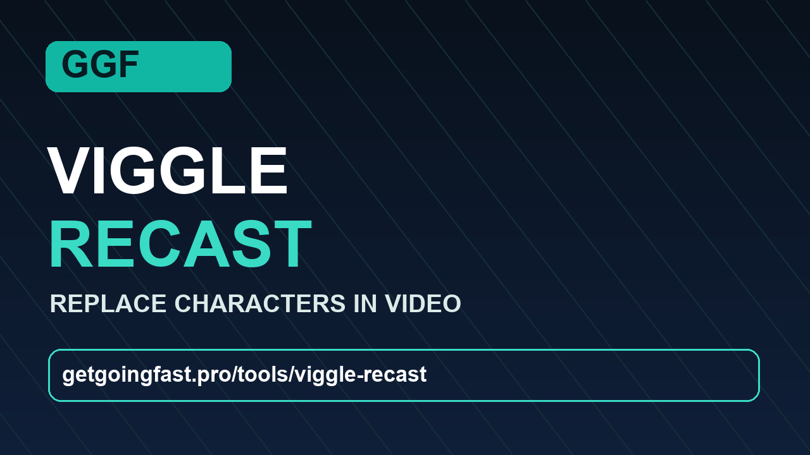

# GGF Viggle Recast

## A Get Going Fast application

### [Quick Setup Helper → GetGoingFast.pro/tools/viggle-recast](https://getgoingfast.pro/tools/viggle-recast)

The quick setup page is pending publication; the manual source instructions below work now.

GGF Viggle Recast replaces up to four characters in a source video using reference images. Select a time range, prepare one cast frame for the entire clip, then generate the finished video with its source audio. **Normal** renders at 736p; **Turbo Mode** renders at 480p. Both use the same INT8 video model. Longer selections are assembled from sections and may show seams.

The video model is [Viggle Remake](https://huggingface.co/Viggle/Viggle-Remake), derived from MiniMax H3. Qwen Image 2.1 prepares reference frames. GGF wrote the application and orchestration code. The published model weights and embedded inference components come from their respective publishers.

## Install and run from source

The [Quick Setup Helper](https://getgoingfast.pro/tools/viggle-recast) is a separate Get Going Fast offering. This public repository contains app source and embedded inference code, but **no model weights or root installer**.

Manual setup is for **Windows with an NVIDIA GPU**. The verified machine has an RTX 4090 (24 GB VRAM) and 128 GB system RAM. Keep at least **85 GB free** for the roughly 73 GB of model downloads and install [Git](https://git-scm.com/download/win), [uv](https://docs.astral.sh/uv/getting-started/installation/), and [FFmpeg](https://ffmpeg.org/download.html) so `git`, `uv`, and `ffmpeg` work in Command Prompt. Other hardware has not been validated.

Open **Command Prompt** in the directory where you want the app and run:

```bat
git clone https://github.com/gjnave/GGF-Recast.git
cd GGF-Recast
uv venv --python 3.11 .venv
uv pip install --python .venv\Scripts\python.exe torch==2.10.0 torchvision==0.25.0 torchaudio==2.10.0 --index-url https://download.pytorch.org/whl/cu130
uv pip install --python .venv\Scripts\python.exe -r requirements.txt
.venv\Scripts\python.exe self_check.py --runtime-only
RUN.bat
```

The installer sets up the private runtime and interface. Start `RUN.bat` and open Recast at `http://127.0.0.1:7877`. If any of the eight required files are missing, Recast opens **Settings** with the **L/iZ** video above **Install / resume**. Click it to download missing weights and verify the whole set against the pinned publisher SHA-256 hashes. Retry the same button after an interruption. **Verify model files** checks existing files offline without downloading. **Refresh model status** picks up an installation completed in another window. Model setup is available on the PC, not through a phone link.

When all files are present at their expected sizes, Recast opens **Create** and hides the helper. Settings distinguishes files that are present from those that have passed a hash check. Known damaged files are flagged and preserved. Generation is local and uses these same files in both modes.

## Use the app

1. Upload a source video and enter start and end timestamps. The app trims and resizes only that selection with FFmpeg. The public tester accepts up to 2 GB per upload and up to 120 seconds per selection.
2. Add reference images and describe which source character each image replaces.
3. Turbo (480p) is selected by default. Choose Normal for 736p detail.
4. Click **Generate video** to prepare missing frames and render. To review or edit frames first, click **Prepare replacement frame**. Prepare again to replace the active cast frame. Generate reuses that frame across sections and keeps the preview visible. Download the finished MP4 from the app.

On the verified RTX 4090, a six-second, two-section Normal render produced 1280 × 736 video with preserved audio and took about **15.5 minutes** for video generation. Real footage, complex occlusion, four-character casts, and the full 120-second range need more testing. Outputs may drift or show section seams. Details are in [README.txt](README.txt) and [SMOKE-TEST.txt](SMOKE-TEST.txt).

## Licenses and model terms

- **GGF application code:** [LICENSE](LICENSE) records this as an internal development preview. No public license for GGF's original application code has been granted by this repository. The source is available to inspect; permission to copy, modify, or redistribute it is not implied.
- **Embedded ComfyUI components:** GPLv3. See [`vendor/comfy_core/LICENSE`](vendor/comfy_core/LICENSE), its [source/provenance note](vendor/comfy_core/SOURCE.md), and [`GGF-SOURCE-ADDITIONS.txt`](vendor/comfy_core/GGF-SOURCE-ADDITIONS.txt). Distribution of a combined package must account for these terms.
- **Viggle inference adapter code:** Apache 2.0; see [`LICENSE-CODE`](vendor/viggle_remake/LICENSE-CODE) and [NOTICE](vendor/viggle_remake/NOTICE). This code license does **not** cover the video model weights.
- **Viggle Remake / MiniMax H3 model weights:** governed by the [MiniMax H3 Community License](https://huggingface.co/MiniMaxAI/MiniMax-H3/blob/main/LICENSE), also copied to [`vendor/viggle_remake/MODEL-LICENSE`](vendor/viggle_remake/MODEL-LICENSE). Its standard applicable territory **excludes the United States, European Union, United Kingdom, and South Korea**. The publisher describes separate authorization for deployment in excluded territories. The agreement also has distribution, use, and commercial-service conditions. This repository grants no model authorization.
- **Qwen Image 2.1 and related image/text weights:** follow their publishers' terms, including the [Qwen Research License for Qwen Image 2.1](https://huggingface.co/Qwen/Qwen-Image-2.1) and the terms on each model or adapter repository. See [MODEL-TERMS.txt](MODEL-TERMS.txt) for the component list.

Use source footage and identities only when you have the rights to do so, and review generated outputs before sharing them. If you are distributing the app or offering a hosted service, review the full upstream agreements and obtain any authorization your use requires.
